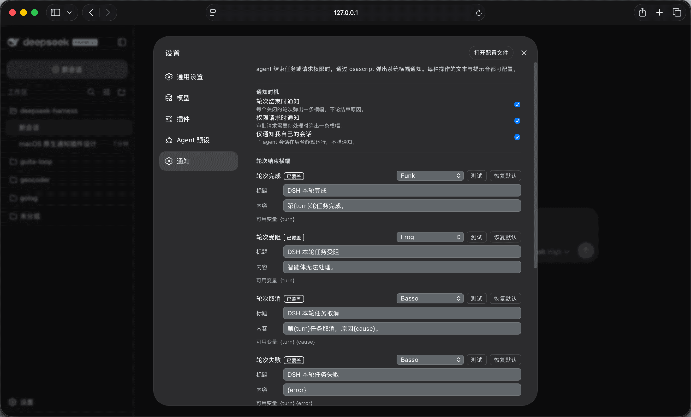
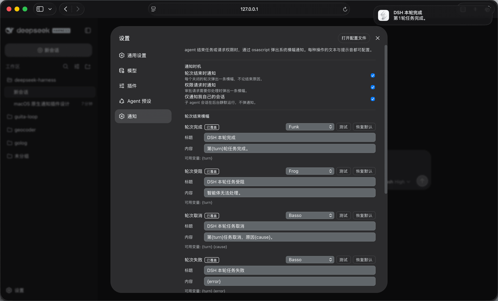

# dsh-macos-notify

English | [中文](README.md) | [GitHub](https://github.com/WShihan/dsh-macos-notify)

Source, issues, and releases: <https://github.com/WShihan/dsh-macos-notify>.

A DeepSeek Harness plugin for macOS: it shows a native Notification Center banner through `/usr/bin/osascript` when an agent turn ends or when a permission request reaches you, and it ships a **Notifications** settings page where every one of those operations gets its own alert sound, title, and body.

The package has two halves. The Host half declares live-editable Cordis configuration and listens to agent events; the browser half contributes a **Notifications** settings section that edits the plugin's profile entry through the shared `ctx.configForms` service. Mounting the package on both planes is the whole wiring — the page writes the same profile entry the Host reads through volatile references, so neither half knows the other's code.

This release targets DeepSeek Harness 0.2.1; `package.json` declares the compatible range under `engines.dsh`, which installation and profile startup both check.

## Triggers, sounds, and text

| Operation | Event | Default sound | Default title | Default body | Settings |
|---|---|---|---|---|---|
| Turn completed | `session/event` → `turn/end` (`completed`) | Glass | `Task completed` | `The agent finished its turn.` | `sounds.completed`, `messages.completed` |
| Turn blocked | `turn/end` (`blocked`) | Funk | `Task blocked` | `The agent could not proceed.` | `sounds.blocked`, `messages.blocked` |
| Turn cancelled | `turn/end` (`aborted`) | Basso | `Task cancelled` | `The agent was cancelled.` | `sounds.aborted`, `messages.aborted` |
| Turn failed | `turn/end` (`error`) | Basso | `Task failed` | `{error}` | `sounds.error`, `messages.error` |
| Token limit reached | `turn/end` (`max-tokens`) | Funk | `Token limit reached` | `The agent hit the output token ceiling.` | `sounds.maxTokens`, `messages.maxTokens` |
| Turn interrupted | `turn/end` (`interrupted`) | Basso | `Turn interrupted` | `The turn was interrupted.` | `sounds.interrupted`, `messages.interrupted` |
| Permission requested | `approval/request` | Ping | `Permission requested` | `{tool} needs {reason}` | `sounds.approval`, `messages.approval` |

A merge-extended turn-end reason this plugin does not know about falls through to the completed operation — its sound and its text.

Sounds are the macOS system alert sounds — `Basso`, `Blow`, `Bottle`, `Frog`, `Funk`, `Glass`, `Hero`, `Morse`, `Ping`, `Pop`, `Purr`, `Sosumi`, `Submarine`, `Tink` — plus `default` (your configured alert sound) and `none` (silent banner, no sound clause at all).

### Placeholders

A title or body may use the placeholders its operation exposes; anything else stays in the text verbatim, so a typo shows up in the banner instead of erasing the sentence around it.

| Operation | Placeholders | Meaning |
|---|---|---|
| Every turn-end operation | `{turn}` | The closed turn's number. |
| Turn cancelled | `{cause}` | Cancellation cause kind (`user`, …). |
| Turn failed | `{error}` | The failure message. |
| Permission requested | `{tool}` | The tool that needs approval. |
| Permission requested | `{reason}` | The asker's reason, or the word `approval` when it gave none. |

`{error}` and `{reason}` are substituted already bounded, and the rendered title and body are each capped at 160 characters, which is what a banner shows.

## Screenshots






## Install

### From the GitHub repository

```sh
dsh plugin --profile web add github:WShihan/dsh-macos-notify
```

This repository version-controls its built artifacts under `lib/`, so the install has no build step: pnpm finds no install script to run, asks for no build allowance, and the plugin loads on the next `dsh web` restart. Pin the exact revision you reviewed when you want the install to stay put:

```sh
dsh plugin --profile web add github:WShihan/dsh-macos-notify#<sha>
```

Update later with the same command, or `dsh plugin --profile web update dsh-macos-notify`.

Cloning and building locally is the path to take while changing the plugin:

```sh
git clone https://github.com/WShihan/dsh-macos-notify
cd dsh-macos-notify
pnpm install
pnpm run build
dsh plugin --profile web add "$PWD"
```

### From npm

```sh
dsh plugin --profile web add dsh-macos-notify
```

This form needs the package published to the registry first. `pnpm pack` packages the same committed `lib/` as an installable tarball:

```sh
pnpm pack
dsh plugin --profile web add ./dsh-macos-notify-0.2.0.tgz
```

### From a local checkout

```sh
pnpm run build     # inside the plugin directory, so lib/ exists
dsh plugin --profile web add /absolute/path/to/macos-notify
```

A local directory is installed as a `link:`, and pnpm neither builds nor installs dependencies for one, so build it first. The Host half is self-contained — besides relative modules its only runtime import is the schema library, which the build inlines — so a linked checkout loads even when the profile's packages are not on that directory's resolution path.

A linked checkout is served from `lib/`, so every source change needs that directory rebuilt and the server restarted:

```sh
cd /absolute/path/to/macos-notify
pnpm run dev          # tsdown --watch: rebuilds lib/ on every save
# then restart `dsh web` and reload the page
```

`dsh web` imports `lib/index.js` at boot and snapshots `lib/client.js` into the served boot graph, so a rebuild alone is not visible until the restart; a page reload is what picks up the new graph. Settings changes need none of this — values edited on the Notifications page are committed into the running configuration references, and the next banner sees them. A linked checkout keeps serving its own `lib/`, so commit the rebuilt files with the source change (see [Committed build output](#committed-build-output)).

An install that prints `declares no dsh.bundle … installed as a plain dependency` added a different package, or a checkout without this manifest. Remove it and add this directory.

### Inside a deepseek-harness checkout

Point a patch overlay at the built entry:

```yaml
- id: macos-notify
  name: 'file:///absolute/path/to/deepseek-harness/macos-notify/lib/index.js'
```

The `id` is required: it is the configuration namespace the settings page uses to find this plugin's form.

Mount the built plugin into a harness that runs built artifacts. A source-launched (`tsx`) harness resolves `@deepseek-ai/*` from source, so the built plugin would load a second Cordis instance; build the harness first (`pnpm run build`).

## Upgrading from 0.1.x

DSH 0.2.1 removed the separate settings document: the page now edits the `config` of this plugin's profile entry directly, with the same field names as 0.1.x. DSH imports the old `$DSH_HOME/settings.yaml` once and renames it to `settings.yaml.imported`; if this plugin was not loaded when that happened (for example because it could not start on the new release), its `macos-notify` section stays in that file instead of reaching the profile. Move it into the profile override by hand:

```yaml
# $DSH_HOME/profiles/web/cordis.patch.yml
- id: macos-notify
  config:
    sounds:
      completed: Funk
    messages:
      completed:
        title: Turn finished
        message: 'Turn {turn} is done.'
```

The old `macos-notify-preview` section was only that era's preview channel; ignore it. `engines.dsh` refuses runtimes before 0.2.1, so upgrading DSH requires upgrading this plugin too.

## Settings page

With this plugin mounted and a settings service composed (`@deepseek-ai/dsh-settings`, which ships in `@deepseek-ai/dsh-base`), the settings panel gains a **Notifications** page of its own, listed in the navigation after General, Models, Plugins, and Agent presets:

- a **When to notify** group with switches for turn-end notifications, permission-request notifications, and "only my own sessions";
- a **Turn-end banners** group and a **Permission banner** group, one block per operation in the table above, each holding that operation's sound select, title, and body, a **Test** button, and a **Reset to default** button once your profile override carries any of them.

Sound and switches commit as you pick them; text is staged and written by **Save** (or dropped by **Discard**), because a settings write is a durable document mutation and committing per keystroke would store edits you never asked for. Every change applies to the next banner — no restart. The page renders its controls only while the Host serves the `macos-notify` entry; without a settings service the composition entry below is the only source and the page renders empty.

### Testing a banner

**Test** sends that operation's banner immediately, so you can judge the sound and the wording before anyone waits on a real turn. It previews the text as it currently reads on the page — including edits you have not saved — with the operation's placeholders replaced by samples (`{turn}` → `1`, `{tool}` → `shell`, `{error}` → `Something went wrong.`, and so on). Testing saves no text and changes no stored sound or wording.

The preview request rides a transient `preview` field in this plugin's own configuration entry (see [Design notes](#design-notes)): the page writes it, the Host fires the banner and clears the request immediately, and the monotonic `nonce` keeps a leftover or repeated request from firing twice. That field is plumbing, not configuration, and normally never stays in the profile.

Because this plugin's configuration owns a page, the Host turns the automatic schema page off (`settings.configure({ auto: false })`), so it contributes no duplicate card under **Settings → Plugins**.

## Composition entry (`cordis.yml`)

Every field is optional; the profile override written by the settings page resolves above it.

| Field | Default | Meaning |
|---|---|---|
| `notifyOnTurnEnd` | `true` | Banner one notification per agent turn that closes. |
| `notifyOnApproval` | `true` | Banner when an approval request reaches the answerer chain. |
| `topLevelOnly` | `true` | Skip sessions owned by delegated subagent work (`delegationDepth > 0`); a user fork stays top-level. |
| `sounds.completed` … `sounds.approval` | see table | Alert sound per operation. An unknown name fails loud at load and is refused as a settings write. |
| `messages.<operation>.title` | see table | Banner title. Every operation under `sounds` has an entry here. |
| `messages.<operation>.message` | see table | Banner body; placeholders from the table above are substituted when the banner fires. |

```yaml
- id: macos-notify
  name: dsh-macos-notify
  config:
    sounds:
      completed: Hero
      approval: Submarine
    messages:
      completed:
        title: 任务完成
        message: 第 {turn} 轮已结束
      error:
        title: 任务失败
        message: '第 {turn} 轮失败：{error}'
      approval:
        title: 需要授权：{tool}
        message: 原因：{reason}
```

## Committed build output

`lib/` is versioned in this repository rather than generated at install time. `lib/index.js` is what the Loader imports and `lib/client.js` is what the client module system serves, so committing them is exactly what lets `dsh plugin add github:WShihan/dsh-macos-notify` work with no install script and no pnpm build allowance.

Anyone changing the plugin is bound by that contract:

- **Rebuild and commit together.** After any change under `src/`, run `pnpm run build` and commit the regenerated `lib/` in the same commit. The repository serves whatever `lib/` holds, so a source change that leaves `lib/` behind ships stale code.
- **Never hand-edit `lib/`.** It is generated output: edit `src/` and rebuild.
- **The package declares no `prepare` or `postinstall` script.** That is deliberate, and it is why a git install needs no `allowBuilds` entry. A fresh clone already has the committed `lib/`; run `pnpm run build` only after editing sources.
- **Commit from the package's own repository.** During development this package sits inside a deepseek-harness checkout, whose root `.gitignore` excludes `lib/`; git applies the outermost file, and a nested `.gitignore` cannot re-include a directory its parent excluded. Copy the package into its own repository first, or `git add -f lib` if you are committing artifacts from inside the checkout.
- **Review `src/`, not `lib/`.** The bundle diff is generated and large; a review that skips it still has to confirm the commit carries a rebuilt copy, and the `pnpm run check` ordering below is what makes that true.
- **Publishing ships what is committed.** `pnpm pack` and `npm publish` upload `lib/` as it stands, so build before publishing.

## Build, test, check

```sh
pnpm install       # installs the toolchain and type packages
pnpm run build     # tsdown → lib/index.js (Host) + lib/client.js (browser)
pnpm run typecheck
pnpm run test      # vitest: Host listeners, settings wiring, page model, page render
pnpm run smoke     # build, then load lib/client.js the way the module loader does
pnpm run check     # typecheck + test + smoke
```

Run `pnpm run check` before committing: it rebuilds `lib/`, so the artifacts you commit are the ones the tests exercised.

`vitest.config.ts` looks for a harness checkout in two layouts: this package inside `<harness>/plugins/macos-notify`, or beside `<harness>` (for example `<parent>/deepseek-harness`). When one is found it aliases `@deepseek-ai/*` to that workspace's sources, so `pnpm run test` needs no harness build; with neither layout the tests use the published packages in `node_modules`, so a standalone clone passes too. `tsconfig.json` always resolves the installed packages' published declarations, so typechecking only needs a successful `pnpm install`.

## The page does not appear

Work through this list; each step rules out one of the ways the two halves fail to meet.

1. **The plugin row is mounted.** `dsh plugin --profile web add …` must not print `declares no dsh.bundle`; `dsh --profile web --dump-config` shows a `# == dsh-macos-notify` layer with an `- id: macos-notify` row.
2. **`lib/` is current.** The profile serves the built `lib/client.js`, from this repository's committed copy or from your rebuild; a source edit without `pnpm run build` (and a restart) changes nothing.
3. **The page was reloaded after a restart.** The boot graph is injected into the index response, so an open tab keeps the old graph until it is refreshed.
4. **A settings service is composed.** The page's controls read and write the `macos-notify` entry through `ctx.configForms`, which needs `@deepseek-ai/dsh-settings` (row id `settings`); it ships in `@deepseek-ai/dsh-base`, so a `web` profile has it by default. The navigation row appears either way; only its controls wait for the entry.
5. **Look for the Notifications row in the settings navigation.** The page is its own section, listed after General, Models, Plugins, and Agent presets — not a card inside Plugins.

## Design notes

- **Banners ride the managed subprocess seam.** Each banner is one `ctx.subprocess.spawn` of `/usr/bin/osascript -e 'display notification …'`; teardown terminates banners still running, and the notification never blocks the event that triggered it. A failed spawn or a non-zero exit is logged as a warning and never reaches the model.
- **AppleScript literals, not shell.** Title and message are escaped as AppleScript string literals (JSON's `\"`/`\\` subset; control characters become spaces) and passed as a single `-e` argument, so no message content is ever shell-interpreted.
- **Observe, never decide.** The `session/event` listener only reads the `turn/end` reason, and the `approval/request` waterfall listener always delegates with `next()`, so it can never claim an approval decision. The `'never'` approval policy short-circuits before the answerer chain, so deterministic rejections produce no banner.
- **Live events, not replay.** `session/event` broadcasts live appends only, so reloading or resuming a session never replays a banner storm.
- **Live configuration references, no remount.** Every editable field is declared `.volatile()`; after a settings write the Loader commits the new values into the stable references and emits `loader/volatile-update`, leaving the plugin instance, its listeners, and any in-flight banner untouched. Every listener reads `.get()` when it fires, which is what makes a change apply to the very next banner.
- **The page edits the profile entry itself.** Through the shared `ctx.configForms` (addressed by profile entry id), the page performs revision-fenced writes validated against the complete Config; they persist to the profile's `cordis.patch.yml`, and there is no separate `settings.yaml`.
- **Text is a template, not a format string.** `{name}` is the whole grammar: the values a firing operation exposes replace their names, and every other character — including an unknown name — reaches the banner as written.
- **The Test button rides the configuration document.** A plugin's browser half reaches the Host only through the generated remote namespaces, and this package ships outside that assembly, so the one channel both halves share is configuration. Test writes a `preview` object into this plugin's profile entry; after the Loader commits it the Host fires the banner and clears the field again, and the monotonic `nonce` in each request is what keeps a leftover or repeated request from firing twice. The field is plumbing, not configuration: it is not documented above and normally stands empty.
- **The browser half is one lazy-CJS bundle.** `lib/client.js` calls `window.__ModuleLoader__.load({ id, factory })` and takes React from the shared module table; everything else — the sound catalog, the page, its store — is inlined. `pnpm run smoke` proves that contract without a browser.
- **Both artifacts are self-contained.** The Host bundle inlines the schema library (schemastery keys its schemas on `Symbol.for('schemastery')`, so an inlined copy stays recognizable to the harness's own), and every `@deepseek-ai/*` import in `src/` is type-only and erased. That is what lets a `link:`ed checkout load without the harness's packages on its own resolution path; Cordis reaches the plugin by service name, not by module identity.

## Known limitations

- **macOS only.** Mounting the plugin on another platform throws at load rather than silently dropping notifications, and there is no cross-platform fallback.
- **Notifications are attributed to Script Editor.** `osascript` posts the banner as the scripting host, so macOS lists it under **Script Editor** in System Settings → Notifications. Allow that app there, or banners stay hidden while the script still exits successfully.
- **Fire-and-forget delivery.** A failed banner is logged and dropped: no retry, no queue, and no in-app fallback when the system suppresses notifications.
- **No throttling.** One banner per turn and per approval request; a long session produces one banner per turn, batched by nothing.
- **Turn is the task unit.** The harness has no durable "task" record, so "task completed" means one agent turn closed.
- **A banner field is capped at 160 characters.** A longer title or body — configured or substituted — is elided with `…`, because Notification Center clips it anyway.
- **Staged text lives only in the open page.** Leaving the settings page with unsaved edits drops them; sounds and switches, which commit immediately, are unaffected.
- **The page and Test need a settings service.** Both travel through `ctx.configForms`, so a deployment without `@deepseek-ai/dsh-settings` has neither the page controls nor the Test button; turn-end and approval banners are unaffected.
- **A write pins the whole entry.** Profile patches replace a row's complete `config`, so after the first page write every volatile field of this entry appears in the profile override; that is the DSH 0.2.1 configuration editor's existing semantic.

## Renaming the package

The package name appears in exactly three places: `"name"` in `package.json`, the `ID` constant in `tsdown.config.ts` (the module-loader id stamped into `lib/client.js`), and the `name` of the row in `cordis.patch.yml`. Rename all three together; the configuration namespace (`macos-notify`) is the `id` of that row and is independent of the package name, so it may stay as it is. `SETTINGS_NAMESPACE` in `src/settings.ts` must match that `id`, or the browser half cannot find its form.

## Model Experience

None. The plugin observes live agent events, sends nothing to the model, and registers no prompt, tool schema, or context.

#### KV Cache effect

It adds no model-visible content, so it neither grows nor invalidates the request prefix.

